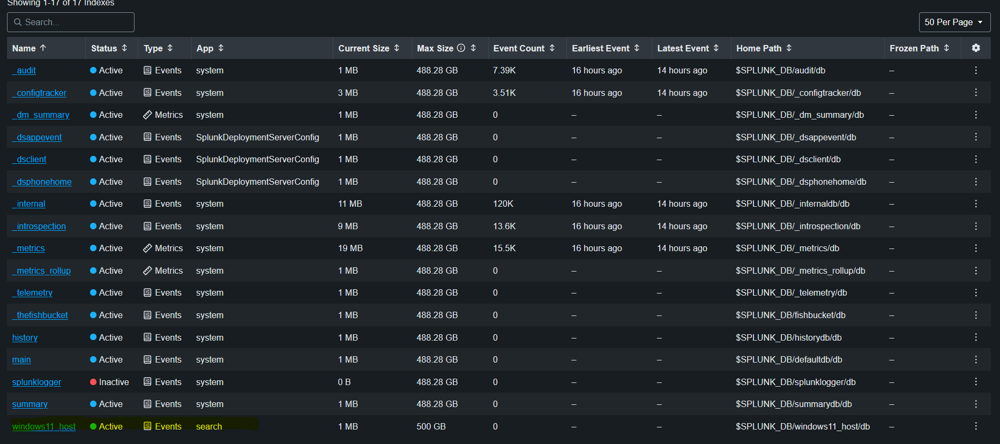
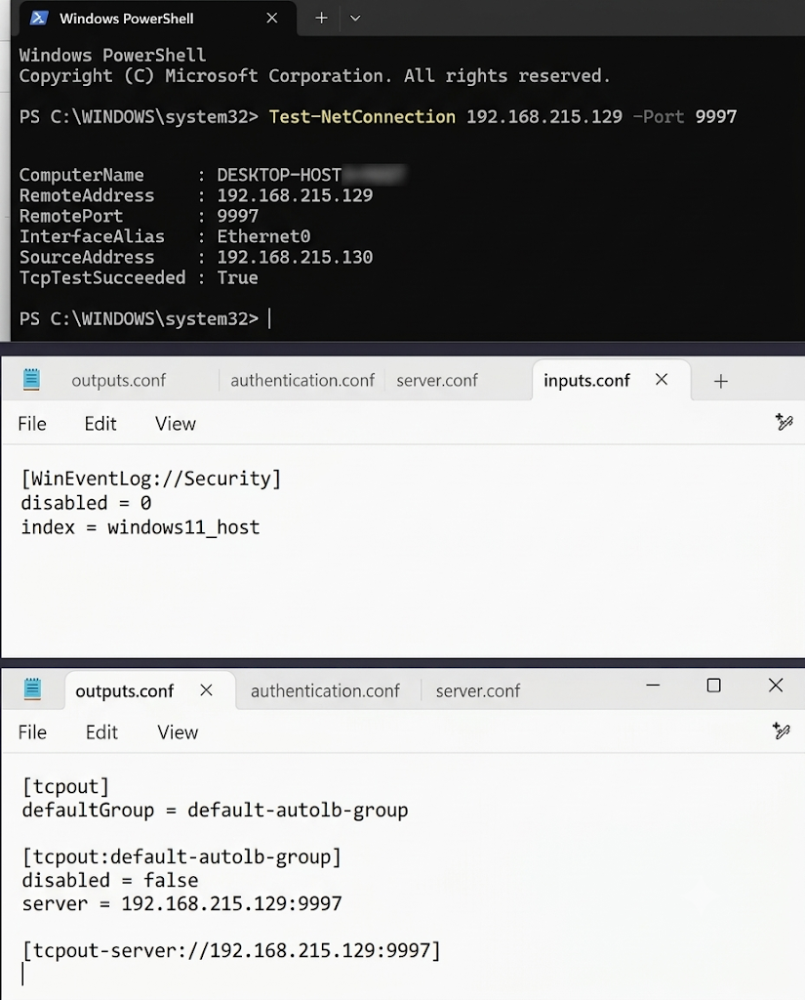
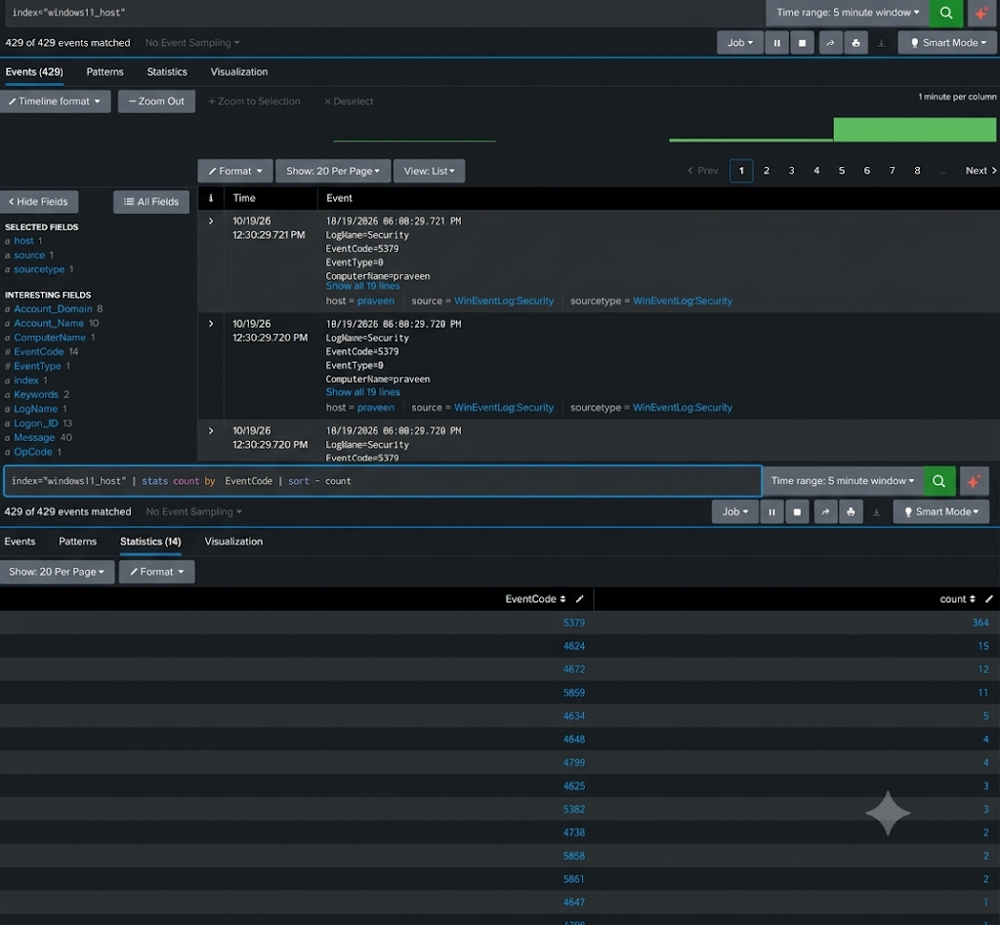
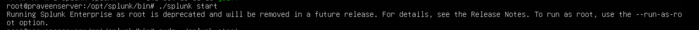
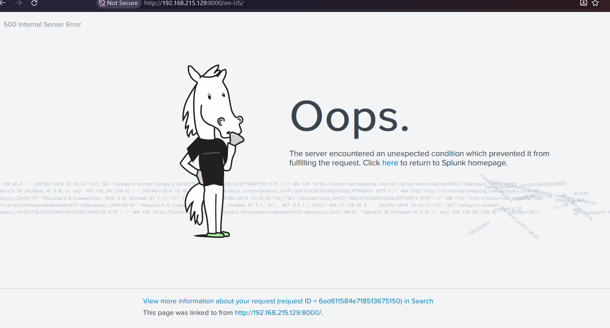
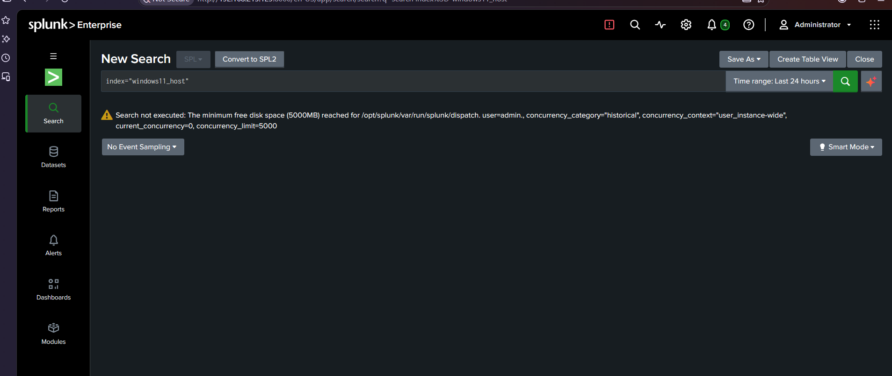

# Splunk SOC Home Lab

This contains a Windows 11 machine sends its event logs to a Splunk Enterprise server running on Ubuntu Server, all inside VMware Workstation.

This repository covers only the basic setup, from installing Splunk to confirming that Windows Security logs arrive and can be searched. It also documents the problems I ran into and how I fixed them.

**Result:** Splunk Enterprise is installed, the Windows 11 Universal Forwarder is connected, and Windows Security logs are searchable in the `windows11_host` index (429 events collected in the first test, see [Verification](#verification)).

## Contents

- [Why I Built This](#why-i-built-this)
- [What This Lab Covers](#what-this-lab-covers)
- [Architecture](#architecture)
- [Lab Environment](#lab-environment)
- [Setup Steps](#setup-steps)
- [Verification](#verification)
- [Troubleshooting](#troubleshooting)
- [Lessons Learned](#lessons-learned)

---

## Why I Built This

I wanted a SIEM lab of my own where I can collect real Windows logs and practice searching and analyzing them, instead of only using hosted training rooms.

I chose **Splunk Enterprise** because it comes with a trial license, and afterwards the free license allows a daily ingest limit (500 MB/day at the time of writing), which is more than enough for a small home lab with one or two machines. Splunk is also widely used in SOC job postings.

## Architecture

```
+---------------------+        TCP 9997         +--------------------------+
|  Windows 11 VM      |  -------------------->  |  Ubuntu Server VM        |
|  Splunk Universal   |   (forwarded events)    |  Splunk Enterprise       |
|  Forwarder          |                         |  Web UI on port 8000     |
+---------------------+                         +--------------------------+
        Both VMs run in VMware Workstation on the same NAT network
```

## What This Lab Covers

- Splunk Enterprise installed and running as a non-root user on Ubuntu Server
- Splunk Web reachable from the host, with firewall rules for ports 8000 and 9997
- A receiving port and a dedicated index for the Windows machine
- A Windows 11 VM with the Splunk Universal Forwarder installed and configured
- Windows Security event logs collected through a `WinEventLog` input and searchable in Splunk
- A disk-space fix with LVM, and the other problems documented in the Troubleshooting section below

## Lab Environment

| Component | Details |
|---|---|
| Hypervisor | VMware Workstation Pro 26H1 |
| SIEM server OS | Ubuntu Server 26.04.1 (live-server, amd64) |
| SIEM | Splunk Enterprise 10.6.1.1 (trial license) |
| Target machine OS | Windows 11 |
| Forwarder | Splunk Universal Forwarder 10.6.1.1 |
| License | Splunk Enterprise trial license |
| Network | VMware NAT, both VMs can reach each other and the internet |
| Splunk index | `windows11_host` |
| Ports | 9997 (forwarder to Splunk), 8000 (Splunk Web) |
| Host machine RAM | 16 GB |

| VM | CPU | RAM | Disk |
|---|---|---|---|
| Ubuntu Server (Splunk) | 2 cores | 3.9 GB | 30 GB, later increased to 40 GB |
| Windows 11 (target) | 2 cores | 4 GB | 64 GB |

---

## Setup Steps

### 1. Splunk Enterprise on Ubuntu Server

1. Installed VMware Workstation and created an Ubuntu Server VM.
2. Downloaded the Splunk Enterprise `.deb` package with `wget` (from the download link on splunk.com).
3. Moved the installer into a `downloads` folder.
4. Installed it:
   ```bash
   sudo dpkg -i splunk-10.6.1.1-<build>-linux-amd64.deb
   ```
5. Changed into the Splunk directory:
   ```bash
   cd /opt/splunk/bin
   ```
6. Fixed the root error and ran Splunk as a dedicated user (see [Problem 1](#problem-1-splunk-would-not-start-as-root)):
   ```bash
   sudo chown -R splunk:splunk /opt/splunk
   sudo -u splunk ./splunk start
   ```
7. Created the Splunk admin username and password when prompted.

### 2. Access Splunk Web from the host

1. Found the VM's IP address with `ip a`.
2. Set the bind address in `/opt/splunk/etc/splunk-launch.conf` (see [Problem 2](#problem-2-splunk-web-would-not-load-in-the-browser)):
   ```
   SPLUNK_BINDIP=0.0.0.0
   ```
3. Opened port 8000 in the firewall:
   ```bash
   sudo ufw allow 8000/tcp
   ```
4. Opened `http://<ubuntu-ip>:8000` in the browser.

### 3. Prepare Splunk to receive logs

1. In Splunk Web: **Settings → Forwarding and receiving → Configure receiving → New Receiving Port → `9997`**.
2. Opened the port in the firewall:
   ```bash
   sudo ufw allow 9997/tcp
   ```
3. Created an index: **Settings → Indexes → New Index → `windows11_host`**.



### 4. Windows 11 VM and Universal Forwarder

1. Created a Windows 11 VM in VMware.
2. Installed the Splunk Universal Forwarder.
3. Pointed the forwarder at the Splunk server (run from `C:\Program Files\SplunkUniversalForwarder\bin`):
   ```powershell
   .\splunk.exe add forward-server <ubuntu-ip>:9997
   ```
4. Confirmed the Windows VM could reach the Splunk receiving port:
   ```powershell
   Test-NetConnection <ubuntu-ip> -Port 9997
   ```
   `TcpTestSucceeded` returned `True`.
5. Created `inputs.conf` in `C:\Program Files\SplunkUniversalForwarder\etc\system\local\`:
   ```ini
   [WinEventLog://Security]
   disabled = 0
   index = windows11_host
   ```
6. Restarted the forwarder:
   ```powershell
   Restart-Service SplunkForwarder
   ```



---

## Verification

Searched in Splunk Web with the time range set to the last 5 minutes.

**Events arriving:**
```
index=windows11_host
```

**Event codes collected:**
```
index=windows11_host | stats count by EventCode | sort -count
```

First result: **429 events in total**. The most common event code was **5379** (about 364 events), followed by the others in the list.

- **5379** is "Credential Manager credentials were read". It is high because Windows reads stored credentials in the background during normal use.
- **4624** (successful logon) appeared about **17 times** after I signed out of Windows and signed back in, which confirms that real user activity reaches Splunk.



---

## Troubleshooting

Problems I hit while building the lab and how I fixed them.

### Problem 1: Splunk would not start as root

**Symptom:** `./splunk start` returned an error, and the error suggested running as root.

**Cause:** The installer was run with `dpkg` as root, so Splunk expected to run as root. Running Splunk as root is not best practice.

**Fix:** Gave ownership of `/opt/splunk` to the `splunk` user and group and started Splunk as that user:
```bash
sudo chown -R splunk:splunk /opt/splunk
sudo -u splunk ./splunk start
```




### Problem 2: Splunk Web would not load in the browser

**Symptom:** Splunk showed as running, but `http://<ubuntu-ip>:8000` did not load from outside the VM.

**What I tried:**
- Without setting `SPLUNK_BINDIP`, the page never loaded.
- Setting `SPLUNK_BINDIP` to the VM's own IP showed the login page, but after logging in Splunk returned a **500 client error**.
- Setting `SPLUNK_BINDIP=0.0.0.0` in `/opt/splunk/etc/splunk-launch.conf` and restarting Splunk worked, together with a firewall rule for port 8000.

**Fix:**
```bash
echo "SPLUNK_BINDIP=0.0.0.0" | sudo tee -a /opt/splunk/etc/splunk-launch.conf
sudo ufw allow 8000/tcp
sudo -u splunk /opt/splunk/bin/splunk restart
```

I did not find the exact root cause of the 500 error with the VM-IP setting. This is the combination that worked in my environment.



### Problem 3: Searches failed because of low disk space

**Symptom:** Running `index=windows11_host` returned an error instead of results.

**Cause:** Splunk needs at least 5000 MB of free space to run searches. The root filesystem had only about 423 MB free (97% used). `lsblk` showed the partition `sda3` was 28 GB, but the LVM logical volume `ubuntu--vg-ubuntu--lv` mounted at `/` was only 14 GB, leaving about 14 GB unallocated.

**Fix:** Extended the logical volume into the free space and resized the filesystem in one command:
```bash
sudo lvextend -l +100%FREE /dev/mapper/ubuntu--vg-ubuntu--lv -r
```
Searches worked after this.



### Problem 4: Monitoring `Security.evtx` as a file

**Symptom:** I first tried to collect the Security log with `splunk add monitor` on `C:\Windows\System32\winevt\Logs\Security.evtx`, and no data showed up in Splunk.

**Cause:** `Security.evtx` is a live binary log that Windows keeps writing to. Splunk's file monitor is meant for text logs and saved `.evtx` archives, not the live system log. Live Windows event logs should be collected with a `WinEventLog` input instead.

**Fix:** Removed the file monitor, created `inputs.conf` with a `[WinEventLog://Security]` stanza, and restarted the forwarder.

### Problem 5: `outputs.conf` vs `inputs.conf`

**Symptom:** The forwarder folder only had `outputs.conf`.

**Cause:** The installer creates `outputs.conf` (where to send data) from the receiving indexer entered during setup. `inputs.conf` (what to collect) is not created automatically.

**Fix:** Created `inputs.conf` by hand in the same folder. The file is `inputs.conf`, with an *s*.

---

## Lessons Learned

- **Check disk space before installing Splunk.** The default Ubuntu LVM layout only used half of the disk, and Splunk refuses to run searches when free space drops below 5 GB.
- **The index must exist before data is sent to it.** Index names in `inputs.conf` and in Splunk must match exactly, otherwise events are dropped.
- **`outputs.conf` and `inputs.conf` do different jobs.** One says where to send data, the other says what to collect.
- **Use the right input type.** Live Windows logs need a `WinEventLog` input, not a file monitor.
- **Set the search time range.** A narrow default range can make working data look empty.
